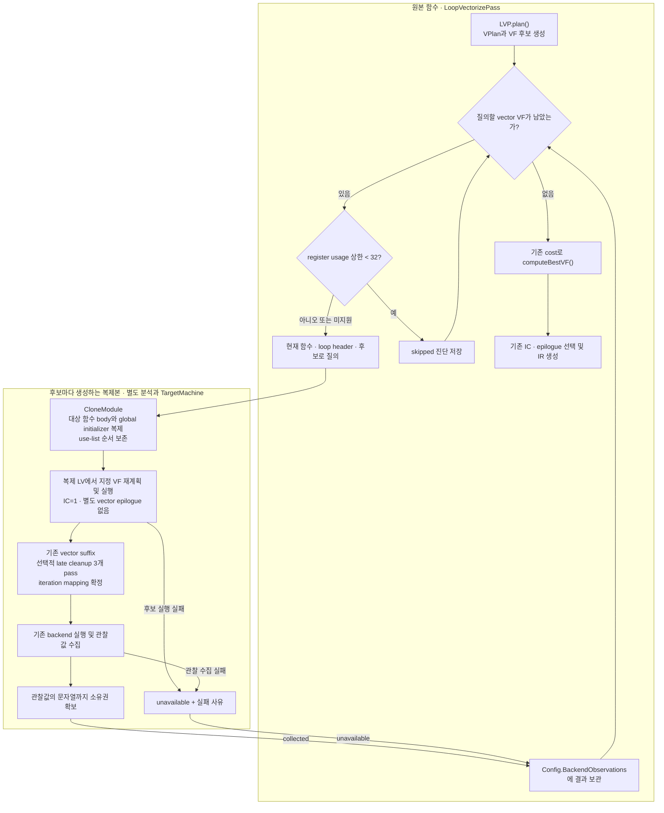
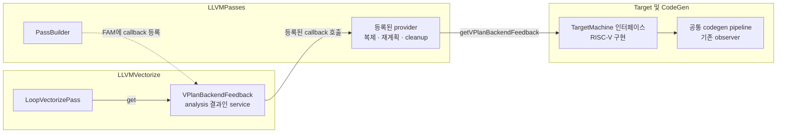
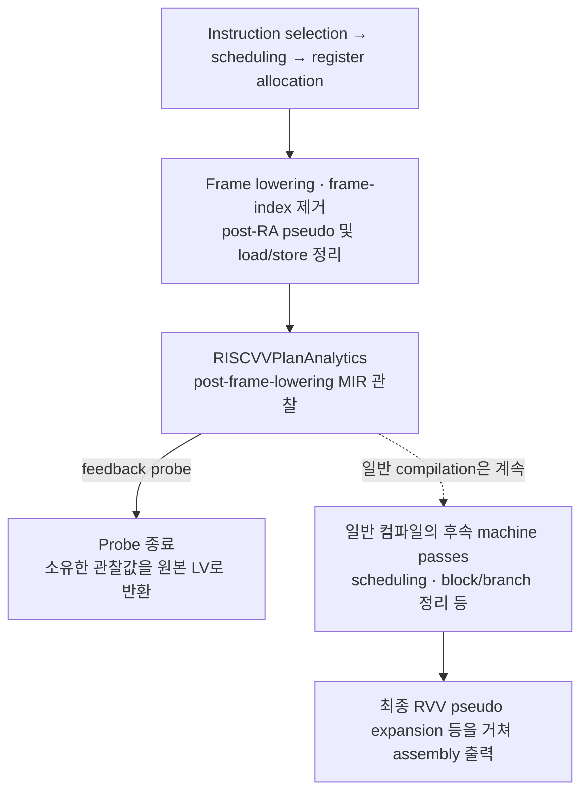

# LLVM vectorizer 내부 backend feedback 경로

기준 상태는 `c8f36b9af1b424827d2aa6f9332287909cd0dfff`이다. 이번 구현은
**VF 후보의 backend 관찰값을 기존 VF 선택 전에 메모리로 반환하는 연구용 경로**다.
Python의 RTL/uop 모델, 비용식, ranking을 LLVM으로 이식하지 않았다.
기존 `LoopVectorizationCostModel`, VPlan cost 계산, `computeBestVF()` 및 실제
출력의 IC/epilogue 선택이 계속 작동한다. 새 경로는 기본적으로 꺼져 있다.

CloneModule에 선택적인 use-list 순서 보존을 추가하여 feedback에서 활성화했다.
기존 DB의 203개 입력, 1,531개 후보를 재검증하면 전체 관찰값 불일치는 137개에서
83개로, 모델 점수 불일치는 18개에서 0개로 줄었다. 추가 late cleanup 옵션을 켜면
raw 불일치는 60개로 줄며 서브에이전트의 양 경로 전체 재실행에서도 재현됐다.
남은 60개는 대상 body의 opcode 순서와 spill 수는 같지만 물리 register가 다르다.
**기존 backend route와 전체 관찰 동등성이 확보된 상태는 아니다**. 수집 불가 4개는
양쪽 모두 같은 memory check에서 벡터화를 거절한 경우이며 후보 정책 차이로
누락 3개도 남는다. 모델 미지원 17개는 별도다.
[검증 결과](BACKEND_FEEDBACK_COMPARISON.md)에 비교 조건, 최종 수치와 원인을 정리했다.
이전 transport 검증의 실행 산출물과 빌드는 정리했다. 이후 register usage gate를
검증하며 다시 만든 컴파일러 빌드는 유지했고, 해당 검증의 임시 스크립트·산출물·로그와
Python 캐시는 삭제했다. 구현·회귀 테스트·재현 도구·검증 결과 문서는 보존했다.

## 빠른 register usage 상한 검사

`llvm/lib/Transforms/Vectorize/VPlanRegisterUsageBounds.{h,cpp}`는 VPlan을
변경하지 않는 독립 분석이다. 기존 register-pressure cost에는 연결하지 않는다.
RISC-V RVV, IC=1, 단일 vector-body block을 지원하며 nested/replicating region과
미지원 probe geometry에서는 기존 backend 질의를 유지한다.

`I`는 vector live-in·materialize되는 상수·uniform 값·header PHI 수다.
이 값들은 loop 전체에 걸쳐 살아 있다고 본다. `D(r)`는 Recipe의 vector 정의 수,
`K(r)`는 소비 Recipe가 r 하나뿐인 비-persistent 입력 값 수다. 중복 operand는
한 번만 세며 PHI/backedge나 외부 사용자가 있는 값은 K에서 제외한다.

```text
B = I + sum(max(0, D(r) - K(r)))
PeakBound = min(I + sum(D(r)), B + max(D(r)))
UsageBound = (PeakBound + HasMask) * MaxRegisterGroup
query = unknown || UsageBound >= 32
```

이는 모든 순서의 peak를 덮는 상한이며 정확한 register saturation은 아니다.
마지막 `max(D(r))`는 입력을 해제하기 전 출력도 필요한 순간을 포함한다.
Mask 값도 개별 VPValue로 센 뒤, mask가 있으면 v0용 슬롯 1을 추가한다.
`MaxRegisterGroup`은 입력·출력·live-in의 예상 물리 vector register 수의 최댓값이다.
Fractional LMUL과 mask는 최소 1이며, mask의 i1은 RVV data element legality와
구분한다. 후보 VF와 reduction PHI의 VF scale factor를 반영한다.
Multi-group 분할, 불명확한 legalization, 산술 overflow는 질의한다.

사용 여부는 worklist로 전파하고 값·Recipe·operand는 상수 횟수만 방문한다.
타입별 TTI 결과를 캐시하며 재귀적인 user 추론이나 schedule 열거는 하지 않는다.
평균 해시 조회 비용을 가정한 후보별 시간은 O(Recipe + VPValue + operand)다.

초기 지원은 consecutive load/store 및 EVL 형태, 기본 정수/FP 산술·비교·select,
단일 단계 cast, mask 논리 연산, broadcast/stepvector와 명시적인 PHI다.
Scalar-only 주소/제어 연산은 vector pressure에서 제외한다. 아래 경우는 명시적으로
질의하며, 새로운 Recipe도 기본적으로 질의한다.

| 종류 | 질의하는 이유/조건 |
|---|---|
| `VPInterleave[EVL]`, `VPHistogram` | 결합 memory operation과 내부 temporary |
| `VPWidenCall`, `VPWidenIntrinsic`, `VPWidenMemIntrinsic` | call clobber 또는 미모델링 lowering |
| `VPReduction[EVL]`, `VPFirstOrderRecurrencePHI`, `VPExpression` | in-loop reduction, splice, expression 확장 |
| `VPWidenIntOrFpInduction`, `VPWidenCanonicalIV` | 암시적인 vector increment 및 중간값 |
| Vector를 요구하는 `VPWidenGEP`, `VPWidenPointerInduction`, `VPScalarIVSteps` | 주소/여러 lane 생성의 확장 |
| `VPReplicate`, `VPBranchOnMask`, `VPPredInstPHI` | 단일 비-predicated scalar replicate 이외의 경우 |
| `VPBlend` | normalized 두 입력의 단일 select 이외 |
| Gather/scatter, reverse/shuffle, build/unpack, active-lane-mask 생성 | 숨은 index/mask/vector 값 |
| `FRem`, 복합 FCmp, 상수 integer div/rem | library/복합 연산/strength reduction temporary |
| Mask↔data cast, bitcast, 여러 단계의 narrowing/FP 변환 | 추가 중간값; integer zext/sext의 vf2/vf4/vf8은 지원 |
| f16/bf16, 기타 미지원 element type/분할 타입 | 승격/분할에 따른 추가 값 |

FP 비교는 `OEQ/OLT/OLE/OGT/OGE/UNE`를 지원한다. 미지원 진단에는 Recipe 이름과
가능한 경우 opcode가 들어간다. 모든 후보의 진단 행에 `register_usage_bound`를
추가하며, 생략된 행은 `status=skipped`이고 `observation`이 없다.
`collected`의 기존 MIR observation 형식은 유지한다.

`-vplan-backend-feedback-force-all`은 진단용 대조 옵션이다. 분석과 `would_skip`
판정은 그대로 수행하되 모든 후보를 질의한다. 이 옵션만으로 feedback을 활성화하지는
않는다. 기존 전체 관찰을 요구하는 분석/transport 테스트는 이 옵션을 함께 사용한다.

전체 검증은 동일 checkpoint의 gate/force-all을 비교하며, timing 로그로 실제
provider 호출 수도 대조한다. 관찰된 생략 후보의 `body_order`에 속한 `spill_slot`
MMO와 vector register operand를 검사한다. Scalar spill과 body 밖 spill은 별도
보고하며 수집 실패나 iteration mapping 실패를 spill 0으로 처리하지 않는다.
단, mapping이 사라진 결과가 successor 없는 단일 machine block인 경우에는 loop가
없는 함수 전체의 vector spill을 검사하여 별도로 검증한다. 이 경우 body 밖의
vector spill도 실패로 처리한다.

```sh
python3 utils/vplan-tools/check-backend-feedback-gate \
  --clang .cache/compiler-build/bin/clang \
  --db /work/mir-port-aware-goal/search-dataset.sqlite \
  --output-dir .cache/feedback-gate-validation --jobs 8
```

기본값은 late cleanup OFF/ON 모두이며 `--benchmark ID`로 입력을 한정할 수 있다.
출력에는 재현 명령, assembly, 후보별 raw 관찰·spill 감사와 summary가 포함된다.
검증 불가 후보는 별도로 집계하며 이 도구는 검증 불가 또는 vector spill 반례가
있으면 비영(非零) 종료 상태를 반환한다.

## 어떤 정보가 필요한가

현재 [cost_model.py](utils/vplan-tools/cost_model.py)는
`mir-local-observation-v2`, `post-frame-lowering` 관찰값을 소비한다.
[기존 계약](VPLAN_RA.md)의 다음 정보가 새 경로에도 그대로 포함된다.

| 필요한 정보 | 기존 공급 코드 / 재사용 방법 |
|---|---|
| 실제 opcode, pseudo/base 대응, MIR 명령 순서 | `vplan::collectAnalytics(MachineFunction&)` |
| LMUL/EMUL, SEW, 증명된 VL/stride, configuration 명령 | 같은 RISC-V collector와 `ObservedValues` |
| 물리 register unit, def/use, clobber, 거리 0/1 RAW edge | 같은 collector, LLVM `ReachingDefInfo` |
| frame lowering 이후 spill/reload, stack 주소 계산, MMO | 기존 `RISCVPassConfig::addPreSched2()` 관찰 지점 |
| body/setup/exit/tail 구분과 circular body | `MachineLoopInfo`, `MachineDominatorTree` 및 기존 collector |
| VF/width, trip count, scalar-tail 정책 | 복제 함수의 기존 LV 분석과 iteration mapping witness |
| scalar iteration cost, configuration TTI unit | 복제 함수에서 기존 `CM.expectedCost(f1)` 및 TTI 질의 |

물리 register allocation과 frame-index elimination의 결과는 일반적인 TTI
instruction-cost 질의만으로 얻을 수 없다. 따라서 TTI에 정적인 수치 몇 개를
추가하는 것으로 현재 입력 계약을 충족할 수는 없다. 반면 RTL 기반 uop 분해,
포트 수요, latency/window 계산은 backend 사실 자체가 아니라 현재 Python 모델의
책임이므로 새 transport에 넣지 않았다.

## 구현한 연결

### 원본 함수와 후보 복제본의 실행 흐름

Feedback이 활성화됐을 때의 흐름이다. 원본 LV가 만든 vector VF 후보마다
`VPlanRegisterUsageBounds`로 먼저 검사한다. 계산 가능한 상한이 32 미만이면
질의를 생략하고, 그 외에는 현재 함수 상태를 복제해 backend까지 실행한다.
반환값은 보관하며 VF 선택은 계속 기존 cost를 사용한다.
그림의 VF 선택으로 향하는 화살표는 실행 순서다.



질의는 동기식이다. 복제본과 backend 상태를 정리한 뒤 원본으로 돌아오며, 다음
후보에는 새 복제본을 사용한다. 초기 지원 조건 검사 등의 조기 실패도 `unavailable`로
돌아온다. LLVM fatal error/assertion의 실패 격리 한계는 아래에 별도로 설명한다.

### 구성 요소 사이의 연결

다음 그림은 실행 중 호출과 callback 등록 관계다. `LLVMVectorize`는 analysis가
돌려준 service를 호출하고, `LLVMPasses`가 등록한 provider가 실제 복제와 backend
실행을 담당한다. 실선은 호출, 점선은 callback 등록이다.



핵심 파일은 다음과 같다.

* [VPlanBackendFeedback.h](llvm/include/llvm/Transforms/Vectorize/VPlanBackendFeedback.h):
  후보 요청, 복제 함수의 probe 상태, analysis/provider 계약.
* [Passes/VPlanBackendFeedback.cpp](llvm/lib/Passes/VPlanBackendFeedback.cpp):
  함수 복제, 분석 및 target 상태 격리, 후보 실행, cleanup, backend 질의.
* [LoopVectorize.cpp](llvm/lib/Transforms/Vectorize/LoopVectorize.cpp):
  `LVP.plan()` 다음의 질의 지점과 복제 함수에 한정된 materialization 분기.
* [LoopVectorizationPlanner.h](llvm/lib/Transforms/Vectorize/LoopVectorizationPlanner.h):
  향후 모델이 읽을 `VFSelectionContext::BackendObservations` 저장소.
* [RISCVTargetMachine.cpp](llvm/lib/Target/RISCV/RISCVTargetMachine.cpp),
  [RISCVVPlanPasses.cpp](llvm/lib/Target/RISCV/RISCVVPlanPasses.cpp):
  target 인스턴스별 sink 및 기존 관찰 pass의 메모리 반환 경로.

`LLVMVectorize`가 `LLVMCodeGen`이나 `LLVMPasses`를 직접 링크하지 않도록
analysis에 callback을 등록한다. `PassBuilder`가 연결을 담당하고 backend 관찰은
`TargetMachine::getVPlanBackendFeedback()`의 target 구현으로 넘긴다.
pipeline 구성 코드에는 기존 codegen 준비 함수를 재사용하는 진입점과
인스턴스별 `TargetPassConfig::setStopAfterPass()`만 추가했다.
전역 `-stop-after`, `-force-vector-width`, 외부 RA replay 상태를 변경하지 않는다.
프로세스 실행, 임시 IR/MIR 파일, Python 호출은 이 경로에 없다.

후보 실행은 기존 `LVP.plan()`과 `executePlan()`을 재사용한다. VPlan을 그대로
다른 Function으로 옮기면 recipe의 IR/SCEV 참조를 전부 다시 매핑해야 하므로,
우선 동일 IR snapshot에서 재계획하는 방법을 택했다. 원본 header는 `ValueMap`으로
매핑하며 plan ordinal, VF 포함 여부, scalar-tail 정책을 검사한다. 복제 함수에서
다른 loop를 다시 vectorize하지 않는다. 후보 ID는 함수/이번 pass invocation/
loop/plan/VF를 구분하며 **영구 cache key나 기존 protocol 4 ID가 아니다**.

`CloneModule`의 새 옵션은 원본 use를 mapped user와 operand 번호로 대응시켜 기존
`Value::sortUseList()`로 복원한다. 기본값은 false이며 feedback에서만 true다.
원본과 같은 LLVMContext에서 공유할 수 있는 non-global constant는 정렬하지 않는다.
이 보완은 use-list 순서 차이를 줄이며, 재계획 및 이후 pipeline 전체의 동일성을
자동으로 보장하지는 않는다.

복제 함수에서만 해당 후보를 선택하고 outside-loop 수익성 판단을 우회한다.
원본에서는 기존 선택 경로를 계속 실행한다. 현재 모델의 관찰 단위에 맞춰
probe는 IC=1, 별도 vector epilogue 없음으로 고정한다. 이는 최종 출력에 적용할
정책이 아니다. 최종 IC/epilogue가 달라지면 관찰값도 그 최종 결과와 동일하다고
간주해서는 안 된다. 명시적 IC>1 또는 강제 vector epilogue 요청은 probe unavailable로
남기고 원본 compilation을 계속한다.

### Backend 관찰 시점

실제 register allocation과 frame 주소 계산을 마친 뒤 관찰한다. 이 시점에는
spill/reload와 주소 계산 명령을 볼 수 있고, RVV pseudo에는 모델에 필요한
geometry가 남아 있다. Probe는 관찰 직후 종료한다.



수집한 opcode 목록은 이 관찰 시점의 MIR 기준이다. 이후 pass가 명령을 바꿀 수
있으므로 최종 assembly의 목록과 동일하다고 간주하지 않는다.

## 반환값과 실패 처리

각 row는 후보 identity/geometry, `status` 및 `observation` 또는 `reason`을 가진다.
`observation`은 기존 schema에 `middle_end`, `scalar_cost`, `feedback_pipeline`을
붙인 값이다. 따라서 기존 `validate_observation()`과 `score_observation()`에
직접 전달할 수 있다. 이것은 **데이터 계약 호환성**이며, 외부 wrapper와 모든
입력에서 같은 기계 코드를 생성한다는 주장은 아니다.

`collected`는 raw 관찰값이 도착했다는 뜻이다. `observation.error`,
`iteration_mapping`, geometry의 unknown 값과 coverage를 계속 검사해야 한다.
multi-block machine loop나 소실된 loop identity를 성공한 model 입력으로 바꾸지
않는다. `unavailable`도 비용 0이나 부적합 VF라는 뜻이 아니다. 현재 선택은 이
상태를 사용하지 않으므로 수집 실패가 기존 VF 결정을 바꾸지 않는다.

기존 collector는 즉시 파일에 쓰기 때문에 `json::Value(StringRef)`를 사용할 수
있었다. 메모리 반환에서는 backend/clone이 사라진 뒤에도 값이 살아 있어야 하므로
sink 경계에서 모든 string value와 object key를 소유하는 값으로 복사한다.
초기 실행에서 이 수명 문제를 재현했고 이 경계로 수정했다. Clang 내부 실행은
부모 `PassBuilder`의 VFS를 전달하여 LLVM IO sandbox에서도 새 real-filesystem
접근을 만들지 않는다.

## 실행 및 검증

빌드는 [README](README.md)의 설정을 사용한다. 빌드가 없는 환경에서는 먼저
`.cache/compiler-build`에 빌드한다. 일반 Clang 호출에 옵션 하나를 추가하면 활성화된다.
아래 JSONL 출력 옵션은 반환 경로를 확인하기 위한 선택적 진단이다.

```sh
.cache/compiler-build/bin/clang kernel.c -S -o .cache/kernel.s \
  --target=riscv64-unknown-elf -march=rv64gcv -mcpu=xiangshan-kunminghu \
  -mrvv-vector-bits=128 -O3 -fno-unroll-loops -fno-slp-vectorize \
  -mllvm -scalable-vectorization=always \
  -mllvm -force-vector-interleave=1 \
  -mllvm -enable-epilogue-vectorization=false \
  -mllvm -riscv-v-register-bit-width-lmul=8 \
  -mllvm -enable-vplan-backend-feedback \
  -mllvm -vplan-backend-feedback-output=.cache/feedback.jsonl
```

JSONL은 append 방식이므로 compilation마다 새 경로를 사용하거나 먼저 비운다.
출력 옵션을 생략해도 질의와 `Config.BackendObservations` 보관은 수행된다.
`-vplan-pipeline=prepare/resume`, candidate manifest, selection input은 필요 없다.

추가 비교용 `-mllvm -vplan-backend-feedback-late-cleanup`은 복제된 함수에
기존 vector suffix 뒤 `LoopSink`, `InstSimplify`, `SimplifyCFG`를 실행한다.
`SimplifyCFG` 옵션은 일반 O2/O3 continuation과 같다. 기본값은 꺼짐이며
원본 함수의 pipeline과 VF selection은 바꾸지 않는다. 켜면 관찰값의
`feedback_pipeline`에 `+late-cleanup`을 붙인다. 이것만으로 일반 continuation의
나머지 pass나 extension callback까지 재현하는 것은 아니다.

`-mllvm -time-vplan-backend-feedback`은 후보별 전체 query, 위 세 pass의 합,
backend 실행 시간을 wall/CPU 초 단위로 stderr에 출력한다. 접두사는
`VPLAN-BACKEND-FEEDBACK-TIMING: `이며 관찰값 schema와 분리된다. 전체 query에는
clone, materialization, cleanup, backend 및 소유 객체의 정리가 포함되며
관찰값의 JSONL/stderr 출력 시간은 포함되지 않는다. 출력 파일 없이 feedback을
활성화한 상태에서도 측정할 수 있다.

`-mllvm -print-vplan-backend-feedback`은 해당 middle-end 수신 지점에서 전체
관찰값을 stderr로 출력하며 feedback도 활성화한다. 기존 backend 출력과의 실제
비교 결과와 비교 도구는 [BACKEND_FEEDBACK_COMPARISON.md](BACKEND_FEEDBACK_COMPARISON.md)에 있다.
전체 203개 입력과 별도 24개 후보의 최종 결과, use-list 순서 보존 및
late cleanup의 효과를 기록했다.

```sh
.cache/compiler-build/bin/llvm-lit -j 16 -v \
  llvm/test/Transforms/LoopVectorize/RISCV \
  llvm/test/CodeGen/RISCV/vplan-ra

PYTHONPATH=utils/vplan-tools \
VPLAN_CLANG="$PWD/.cache/compiler-build/bin/clang" \
  python3 -B -m unittest discover -s utils/vplan-tools/tests -q
```

추가한 [LLVM test](llvm/test/Transforms/LoopVectorize/RISCV/backend-feedback.ll)는
두 함수/세 loop의 모든 후보, 소유한 결과의 직렬화, 후보 geometry,
register/메모리/dependency 필드, 출력 파일 없는 경로, IC=2 unavailable을 확인한다.
feedback on/off의 IR를 그대로 비교한다.
[Python integration test](utils/vplan-tools/tests/test_feedback.py)는 직접 Clang을
호출해 assembly 동일성 및 기존 모델 입력/계산의 호환성을 확인한다.
12개의 독립 reduction으로 register pressure와 spill이 생기는 경우도 포함한다.
Python은 테스트에서만 사용하며 compiler 경로에는 들어가지 않는다.

2026-10-25 검증 결과: Utils unit test **183/183**, 관련 LLVM lit **149/149**,
Python **73/73** 통과.

2026-10-26 register usage gate 검증 결과: Vectorize unit test **75/75**,
관련 LLVM lit **149/149**, Python **81/81** 통과. 203개 입력의 backend 질의는
모드별 1,528회에서 815회로 **46.66% 감소**했다. 생략 후보 713개 중 관찰 가능한
710개에서 대상 RVV spill/reload는 0이었으며, 후보가 생성되지 않은 3개는 검증 불가로
남겼다. 상세 조건과 한계는 [검증 결과](BACKEND_FEEDBACK_COMPARISON.md)에 있다.

## 통합 전에 남는 범위

1. **Pipeline 계약.** 현재 probe는 `addVectorPasses`의 LV 이후 부분과 backend를
   실행하고 선택적으로 세 cleanup pass를 추가한다. 원본 compilation의 이후
   module passes, LTO, plugin EP, sanitizer 등을 모두 재현하지 않는다.
   `feedback_pipeline`은 backend optimization level로
   고른 O2/O3 suffix를 기록한다. PGO/profile summary 입력은 명시적으로 거절한다.
   실제 선택에 활용하기 전에는 지원할 compilation pipeline과 IC/epilogue 조합을
   확정하고, 최종 lowering과의 차이를 검증해야 한다.
2. **재계획의 동일성.** ordinal/VF/tail 검사는 기본 방어다. 사용자 정의 AA,
   module summary 등으로 planning context가 달라지는 일반화까지 보증하지 않는다.
   그런 범위를 지원하려면 분석 환경을 더 전달하거나 recipe/decision fingerprint를
   대조해야 한다. 직접 VPlan remapping은 그 이후 검토할 최적화다.
3. **비용.** 후보별 선형시간 상한 검사 후 질의하는 K개 후보에 대해서만 함수 복제,
   LV 재계획, cleanup, backend를 실행한다. 그 부분의 비용은
   `O(K × (clone + planning + cleanup + codegen))`이다. Cache/batching은 없고
   feedback 자체는 기본 비활성 상태를 유지한다.
4. **실패 격리.** 일반적인 unavailable/unsupported 결과는 반환하지만 LLVM backend의
   fatal error/assertion은 같은 프로세스를 종료할 수 있다. 프로세스 격리와 동일한
   내고장성을 주장하지 않는다. New PM, RISC-V, inner-loop 연구 경로가 검증 범위다.
   diagnostic/statistics에는 복제 함수 실행도 나타날 수 있다.
5. **향후 모델 연결.** `Config.BackendObservations`에서 유효한 관찰을 찾는 accessor와
   C++ 입력 adapter를 붙이는 것이 다음 연결 지점이다. 이번에는 score 생성, 비용
   대체, candidate pruning, 선택 정책을 추가하지 않았다. scalar f1은 별도 MIR 후보로
   실행하지 않고 기존 scalar TTI 비용을 유지한다.

선택지 비교에서 TTI만 확장하는 방법은 필요한 실제 allocation 정보를 제공하지
못하고, LLVM-MCA만 사용하면 현재 LLVM MIR/RTL 모델 계약을 바꾸게 된다.
loop만 extract하면 주변 live range와 register allocation 조건이 달라진다.
따라서 이번 단계에서는 **함수 clone + 기존 LV materialization + 기존 backend
observer + analysis callback**을 우선 경로로 삼는다.

LLVM의 [VPlan 설계 문서](https://llvm.org/docs/VectorizationPlan.html)는
planning과 실제 transformation의 분리를 설명한다.
[Code generator 문서](https://llvm.org/docs/CodeGenerator.html)는 instruction
selection, scheduling, register allocation, frame lowering의 단계 구성을 설명한다.
구체적인 hook과 stage 판단은 위 기준 commit의 로컬 소스를 우선 근거로 삼았다.

구현 방향 자체를 폐기하거나 교체한 시도는 없으므로 `FAILURE.md`/실험 stash는
만들지 않았다. 기존 stash는 유지했다. 이후 방향을 바꿀 때는 원인과 재현/검증
자료의 위치를 `FAILURE.md`에 적고, untracked 소스까지 포함해 stash한 뒤 위 기준
상태에서 다음 구현을 시작한다.
